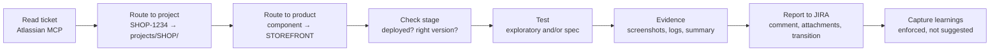

# QA Agent Blueprint for Claude Code

**A Git blueprint that turns Claude Code into a learning QA Manager + Tester.**
Hand it a JIRA ticket — it tests or re-tests the ticket autonomously, produces
evidence, reports back in your project's format, and remembers what it learned.

Exploratory testing runs through Playwright MCP, regression through the Playwright
CLI runner, tickets through the Atlassian MCP server. Everything the agent knows
about *your* projects lives in plain Markdown files in your repo — reviewable,
diffable, and shared with your team through Git.

> **👉 [Check out the detailed overview](https://sn4kygit.github.io/claude_blueprint/overview.html)** —
> the whole architecture rendered as a one-pager: five layers, 13 core skills,
> five verdicts, and what is enforced rather than merely written down.

> **This is a public blueprint.** It contains no credentials, no internal URLs, no
> customer systems. Everything site-specific is onboarded into `projects/<KEY>/`
> at your end.

| | |
|---|---|
| **Target** | Atlassian Cloud (JIRA + Confluence), remote MCP server, OAuth 2.1 |
| **Contents** | 23 skills · 5 subagents · 5 always-loaded rules + 9 on demand · 4 hooks · 96 fixtures · 8 eval cases |
| **Two ways in** | Merged into your repo (integrate), or as a plugin |
| **License** | MIT |

---

## What it actually does

You type `/test-ticket SHOP-1234`. The agent then:



In words: *"Ah — project SHOP, product STOREFRONT, so test user `qa-standard`,
stage needs a deploy first, checkout is behind the `NEW_CHECKOUT` flag, report as a
JIRA comment with screenshots, transition to Verify."* None of that was in the
prompt. All of it came from files the agent read because the ticket key told it to.

### The five things that make it different

1. **It knows your projects — and their products.** A project file holds test users
   (as vault references, never passwords), environments, deploy runbook, pipelines,
   report format and gotchas. If one JIRA project covers several products with
   different test methods, features or test users, each product adds a short file
   stating only what *differs*.
2. **Evidence is mandatory, and enforced.** No verdict without artifacts and a
   machine-readable `execution_summary.json`. A Stop hook blocks the session end
   otherwise — it is not a polite request.
3. **Learning is enforced too.** Every run declares what it learned, or why nothing
   came up. The same Stop hook checks the declaration; the SessionStart hook shows
   how much is waiting to be groomed. "Explain once, never again" stops depending
   on goodwill.
4. **It is token-efficient on purpose.** A slim router, skills that load on demand,
   subagents that keep browser transcripts out of the main context, and a CLI runner
   roughly 4× cheaper than driving the same flow through MCP.
5. **Rules are advisory; hooks are not.** Anything that must hold — evidence,
   secrets, destructive commands, learning capture — is enforced by a hook with
   fixtures proving it blocks.

---

## Quickstart

**Recommended mode: plugin.** Nothing is copied into your project — rules,
skills, agents and hooks load from the plugin; only your own data
(`projects/`, `memory/`, `evidence/`) lives in your repo.

### The standard way: clone + installer

```bash
git clone https://github.com/Sn4kyGit/claude_blueprint.git
cd claude_blueprint
./install.sh            # asks how you want it, then sets that up
```

Run in a fresh clone it sets up the blueprint repo itself. Run it **from inside
your own project** and it asks which of the two ways in you want — integrate or
plugin — and explains the trade-off before you pick. Pick **plugin** for the
recommended mode.

### Plugin-only, without a clone

If you only want the plugin and trust the GitHub source, you can skip the clone
and wire the marketplace yourself. Add these two keys to your project's
`.claude/settings.json`:

```json
{
  "extraKnownMarketplaces": {
    "qa-agent-blueprint": {
      "source": { "source": "github", "repo": "Sn4kyGit/claude_blueprint" }
    }
  },
  "enabledPlugins": {
    "qa-agent-blueprint@qa-agent-blueprint-marketplace": true
  }
}
```

Restart Claude Code and accept the trust dialog. On first session start the
plugin's SessionStart hook bootstraps `projects/`, `memory/`, `evidence/` and a
`.env.playwright-secrets` placeholder in your repo, and injects the router.

For more details — detection matrix, per-file collision policy, plugin
mechanics, FAQ — have a look at [docs/integration.md](docs/integration.md).

### First session

Either way, then start Claude Code in your project:

```
/mcp                    # one-time: authorize "atlassian" (OAuth 2.1)
/onboard-project        # teach it your first project (~30–60 min, interactive)
                        # → read docs/pilot-briefing.md first; it lists what to collect
/onboard-product        # only if that JIRA project covers several products
/test-ticket SHOP-123   # test a ticket end to end
```

Prerequisites: Node.js LTS (≥ 18) and npm · Claude Code CLI · an Atlassian Cloud
site · optionally a vault/password manager for test-user credentials.

---

## How knowledge is organized

Five layers, each with its own loading behavior — this is what keeps the token cost
down:

| Layer | What | When it loads |
|---|---|---|
| **1 · Core** | `CLAUDE.md` router + 5 rule files in `.claude/rules/core/` | always — the norms only (~6.7k tokens, measured) |
| **1b · Rule details** | `docs/rules/` | on demand — the detail behind a rule, when its topic comes up |
| **2 · Skills & subagents** | `.claude/skills/`, `.claude/agents/` | on demand |
| **3 · Project & product** | `projects/<KEY>/` + `products/<PRODUCT>/` | active project only |
| **4 · Learning system** | `memory/` | grows, gets consolidated |
| **5 · Evidence** | `evidence/<KEY>/<TICKET>/<ts>/` | never — referenced by path |

### Projects and products

```
projects/SHOP/
├── PROJECT.md              # applies to ALL products; holds the routing registry
├── learnings.md
├── templates/bug-report.md
└── products/               # absent entirely for single-product projects
    ├── STOREFRONT/
    │   ├── PRODUCT.md      # states ONLY what differs (~60 lines)
    │   └── learnings.md
    └── ADMIN/
```

A product **inherits** the project file and overrides only what it names. Some
fields are **sealed** and can never be overridden — JIRA transitions and report
format belong to the JIRA workflow, and deploy authorization is read from the
project file alone, so no product file can grant itself permission to deploy.

Tickets route to a product by JIRA component, then label, then secondary signals
(epic, fix version, changed paths in the linked MR). Ambiguous? It asks — and in
headless CI it reports BLOCKED rather than guess. A declared default resolves
*silence*, never a *conflict*.

**Single-product projects see none of this.** No `products/` directory, no routing
section, no extra reads — byte for byte the behavior from before the layer existed.

---

## What's in the box

<details>
<summary><b>13 core skills</b> — the ticket workflow</summary>

| Skill | Purpose |
|---|---|
| `/test-ticket` | Full workflow: read → route → stage-check → test → evidence → report |
| `/retest-bug` | Focused re-test of a fixed bug + a tight regression sweep |
| `/exploratory-testing` | Chartered SBTM session via Playwright MCP |
| `/playwright-regression` | Write/run deterministic specs via the CLI runner |
| `/failure-analysis` | A failing test triaged: real defect, or is the test case itself outdated? Proposes, never applies |
| `/bug-report` | A bug report exactly per the project's (or product's) template |
| `/report-to-jira` | Comment + attachments + the correct workflow transition |
| `/deploy-to-stage` | The project's deploy runbook, with safety checks |
| `/onboard-project` | Teach the agent a new project |
| `/onboard-product` | Teach it one product of a project (5–15 min, differences only) |
| `/scaffold-suite` | Create the Playwright project the evidence policy needs — config *is* the capture matrix |
| `/qa-report` | Aggregate the evidence into metrics: pass rate, P0/P1, BLOCKED reasons, routing quality |
| `/retro-learn` | Capture, groom and promote learnings |

</details>

<details>
<summary><b>10 specialist skills</b> — vendored, MIT</summary>

`api-testing` · `accessibility-testing` · `security-testing` · `visual-testing` ·
`risk-based-testing` · `bug-reproduction` · `test-reliability` · `qa-metrics` ·
`test-case-management` · `release-readiness`

Adapted from [petrkindlmann/qa-skills](https://github.com/petrkindlmann/qa-skills);
see `.claude/skills/THIRD_PARTY_NOTICES.md`. `qa-manager` reaches for one when a
ticket calls for it — driven by the product's feature/test-method matrix rather
than by guesswork.

</details>

<details>
<summary><b>5 subagents</b> — separate context windows</summary>

| Subagent | Role |
|---|---|
| `qa-manager` | Orchestrates one ticket end to end; decides strategy, delegates, quality-gates the result |
| `test-executor` | Exploratory testing and bug reproduction via Playwright MCP |
| `test-automator` | Deterministic specs via the Playwright CLI runner |
| `failure-analyst` | Triages a FAIL before a bug is filed — holds no `Write`, so it can never edit a test green |
| `bug-reporter` | Composes the bug report against the project's template |

A 30-step browser session stays inside `test-executor`; only a verdict comes back.

</details>

---

## What is enforced, not just written down

Rules are advisory. These are not:

| Hook | Enforces | Fixtures |
|---|---|---|
| `pre-tool-guard` | No writes to `.env*` or secret-named paths, no `rm -rf`, no force-push | 23 |
| `stop-evidence-check` | No verdict without `execution_summary.json` — **and** without a `learnings` declaration | 17 |
| `session-start` | Orientation: projects and their products, ungroomed learnings, missing secrets file, first-run MCP hint; plugin mode injects `CLAUDE.md` verbatim | 13 |
| `post-jira-audit` | Every JIRA write lands in an append-only audit log, headless runs included | — |
| `install.sh` (not a hook, same standard) | Namespacing, path rewriting, idempotency, uninstall, plugin wiring, self-setup | 43 |
| `context-budget` | The always-loaded layer stays inside its budget | measured, not asserted |

> **Why the fixtures exist.** The PreToolUse guard silently blocked *nothing* for
> the entire life of this repo: its Python expressions were mis-quoted, the parser
> failed, every check was skipped — and it looked correct in review. A hook counts
> as enforcement only once a test proves it blocks. `install.sh` has its own
> end-to-end suite because it is the one artifact that writes into *other people's*
> repos: it integrates into a throwaway repo, checks that the namespaced path
> rewriting leaves no dangling reference, that a second run changes nothing, and
> that uninstall removes only what it added. Run everything with
> `for t in .claude/hooks/tests/*.sh; do bash "$t"; done`.

---

## The learning loop

```
Capture  →  Groom  →  Promote
(enforced)  (visible)  (automatic on the 2nd sighting)
```

- **Capture** — every run declares its `learnings` in the summary: what went into
  `memory/learnings/_inbox.md`, or one sentence on why nothing did. The Stop hook
  blocks a session that skips the declaration.
- **Groom** — `/retro-learn` dedupes, bumps `seen:` counters, deletes what no
  longer holds. SessionStart reports the backlog so it cannot grow quietly.
- **Promote** — seen twice, it moves into a rule, a `PROJECT.md` or a `PRODUCT.md`,
  where it is loaded automatically and never explained again.
- **Routing improves itself** — a rule a human states once lands in the product
  registry immediately; a single case answered twice is promoted into it. An
  exception never becomes a rule.

---

## What you configure

| Thing | Where | Notes |
|---|---|---|
| Project knowledge | `projects/<KEY>/PROJECT.md` | Written by `/onboard-project`, never guessed |
| Product knowledge | `projects/<KEY>/products/<PRODUCT>/` | Optional; only what differs |
| Quality gates | `PROJECT.md` → gate overrides | Defaults: pass rate ≥ 80%, P0 = 0, P1 ≤ 5 |
| Report format & transitions | `PROJECT.md` → Reporting | `jira-cloud` or `plain-text`; fetched from JIRA during onboarding, never guessed |
| Deploy trigger | `PROJECT.md` → "How a deploy is triggered" | The exact command (`gh workflow run …`) or "manual". `/deploy-to-stage` preflights it and reports BLOCKED if it is missing |
| Shadow mode | **On by default** — off via `QA_AGENT_SHADOW=0` or `PROJECT.md` → Reporting | Tests fully, posts nothing; grant write access after the first weeks of reviewed proposals |
| MCP servers | `.mcp.json` + register in `docs/rules/core/token-discipline.md` | Declared set, not a fixed number — see below. A CI CLI is a Bash command, not a server |
| Context budget | `.claude/hooks/tests/context-budget.sh` | What every session pays before a skill loads; the check fails when it grows |
| Evidence retention | `docs/artifact-strategy.md` | Documented, **not implemented** — nothing prunes `evidence/` yet |

**MCP servers are a register, not a limit.** `playwright` and `atlassian` are in it
because a QA agent cannot work without a browser and a ticket system. Adding a
third — a vault server for test-user credentials, say — is a deliberate decision:
wire it in `.mcp.json` and give it a row with its reason. The agent never adds one
on its own initiative; it proposes, you decide. A credential server may resolve a
*reference* for the tool that needs it and must never surface a value into the
transcript, a file, a ticket, or an artifact.

---

## Bringing it into an existing repo

Already have your own `CLAUDE.md`, skills, and `.mcp.json`? Two supported paths.
**Trying it out → plugin (the Quickstart's recommended mode). One repo,
long-term → integrate. Many repos → plugin.**

| | **A) Checkout + integrate** | **B) Plugin** |
|---|---|---|
| Lands in your repo | Rules, skills, agents, hooks — copied, namespaced | Nothing but your own data (`projects/`, `memory/`, `evidence/`) |
| Logic lives in | Your repo, in your commits | The plugin cache, updated via `/plugin` |
| Commands | `/test-ticket`, `/onboard-project`, … | `/qa-agent-blueprint:test-ticket`, … |
| Best when | You want it reviewable and editable by your team | You want zero footprint across many repos |
| Setup | `install.sh` once | `install.sh` writes the two keys, then restart |

**A — integrate.** Preview first, it changes nothing:

```bash
git clone https://github.com/Sn4kyGit/claude_blueprint.git ~/tools/claude_blueprint
cd ~/work/your-project
~/tools/claude_blueprint/install.sh --dry-run   # prints the full plan
~/tools/claude_blueprint/install.sh             # or --yes for non-interactive
```

Every step is reported as `ADDED` / `MERGED` / `SKIPPED` / `WARN`. Merges are
non-destructive by design: your `CLAUDE.md` gets a marked block appended (with a
backup), rules and hooks are namespaced under `qa-blueprint/` so they cannot
collide, `.mcp.json` merges by server name with yours winning, and a name collision
in skills or agents is skipped with a warning rather than overwritten. Running it
twice changes nothing. `--uninstall` removes only what it added.

**B — plugin.** Same script, pick option 2 — it merges the two required keys into
your `.claude/settings.json` (with a backup, keeping everything else, and doing
nothing on a re-run):

```bash
~/tools/claude_blueprint/install.sh --mode plugin --target .
```

It registers the marketplace against your **local checkout**, which is the honest
default: the code you enabled is the code you can read. To track a remote instead,
change the source afterwards — note that the repository is `claude_blueprint` while
the plugin and its marketplace are named `qa-agent-blueprint`, so the enabled-plugin
key does not change:

```json
"source": { "source": "github", "repo": "Sn4kyGit/claude_blueprint" }
```

Restart Claude Code and accept the trust dialog. Since plugins don't load
`CLAUDE.md`, a SessionStart hook injects the plugin's `CLAUDE.md` verbatim as
session context (one router text, no drift between install modes) and creates
`projects/`, `memory/`, `evidence/` plus a `.env.playwright-secrets` placeholder —
the Playwright server exits at startup without that file, which otherwise shows up
only as a connection error.

Full detection matrix, per-file collision policy, plugin mechanics and an FAQ:
**[docs/integration.md](docs/integration.md)**.

---

## Security & privacy

- **No secrets in this repo, and none in context.** Credentials are vault paths or
  env keys — never values, not in chat, code, tickets, or screenshots.
- Playwright MCP runs with `--secrets .env.playwright-secrets`, so passwords are
  masked in every tool response, and `--isolated`, so no state leaks between runs.
- Hook-level enforcement blocks `rm -rf`, force pushes, and writes to `.env*`
  files; a permissions denylist prevents reads of known secret patterns.
- Stage only. Never production — regardless of who asks or how it is framed.
- `evidence/` is gitignored, so artifacts never enter the repo. Keeping them out of
  the *model context* is a discipline rule, not an enforced boundary: Claude Code
  does not currently honor `.claudeignore` for tool reads. For a hard boundary, add
  `Read(evidence/**)` to `permissions.deny`.

Details: `.claude/rules/core/security.md` · `docs/artifact-strategy.md`.

---

## Deliberate non-goals

- **No memory server.** Semantic recall solves a different problem than promotion —
  and relieves the pressure to condense knowledge into the files that load for
  free. A local store also isn't shared with your team, which is the whole point.
  Reasoning and the conditions under which to revisit: `docs/memory-layers.md`.
- **No pipeline edits.** The agent consumes quality gates; it never edits workflow
  definitions or disables a gate to get a green run.
- **No merges, approvals, or rollbacks.** It comments test results; humans decide.

### Not built yet, and honest about it

Web only (Chromium, headless) — no mobile, cross-browser or native testing. One
ticket at a time — epics and releases have no rollup. No test-data lifecycle and no
stage leases, so parallel testing on a shared stage will confuse itself. No
write-back into a test-management system. `evidence/` grows forever. And no project
has been onboarded for real yet: everything here is verified against fixtures and a
fictional reference project, which makes the first pilot the actual test —
[docs/pilot-briefing.md](docs/pilot-briefing.md) says what that means for whoever
runs it.

---

## Documentation

| Document | Contents |
|---|---|
| [docs/architecture.md](docs/architecture.md) | The five layers and why they are token-efficient |
| [docs/integration.md](docs/integration.md) | Integrate vs. plugin, detection matrix, FAQ |
| [docs/artifact-strategy.md](docs/artifact-strategy.md) | Evidence capture, retention, PII |
| [docs/memory-layers.md](docs/memory-layers.md) | Repo learnings vs. auto memory; no memory server |
| [evals/README.md](evals/README.md) | Semantic test cases — routing, merge, sealed fields, rule reachability — plus a runner that works today |
| [docs/pilot-briefing.md](docs/pilot-briefing.md) | **Read before the first real onboarding**: what to collect, shadow mode, what is known unfinished |
| [docs/rules/](docs/rules/) | The detail behind each always-loaded rule, read on demand |
| [docs/runbooks/stage-deploy-general.md](docs/runbooks/stage-deploy-general.md) | Generic stage-deploy scaffold |

Inside the repo, `memory/INDEX.md` is the map the agent reads first.

---

## Contributing

One hard rule: **never commit project-specific data.** Keep `projects/_template/`
generic, keep real onboardings in your private fork, and route durable improvements
through `/retro-learn` so they land in rules, skills, or templates instead of as
one-off edits.

Before opening a PR: run `bash -n` on any script you touched, keep all JSON valid,
and run every fixture suite — `for t in .claude/hooks/tests/*.sh; do bash "$t"; done`
must print `all fixtures passed` four times. A new enforcement rule needs a new
fixture; that is not negotiable, for the reason documented above. Touched
`install.sh`? The integrate suite is the one that catches what a dry-run cannot.

## License

MIT. Methodology draws on Google testing standards (AAA pattern, quality gates),
OWASP Top 10 smoke testing, and blameless SRE retrospective practice (5-Whys RCA).
