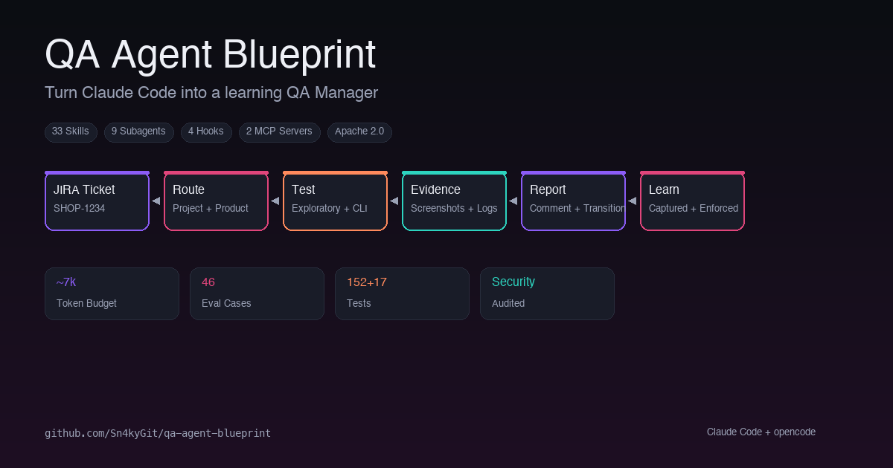
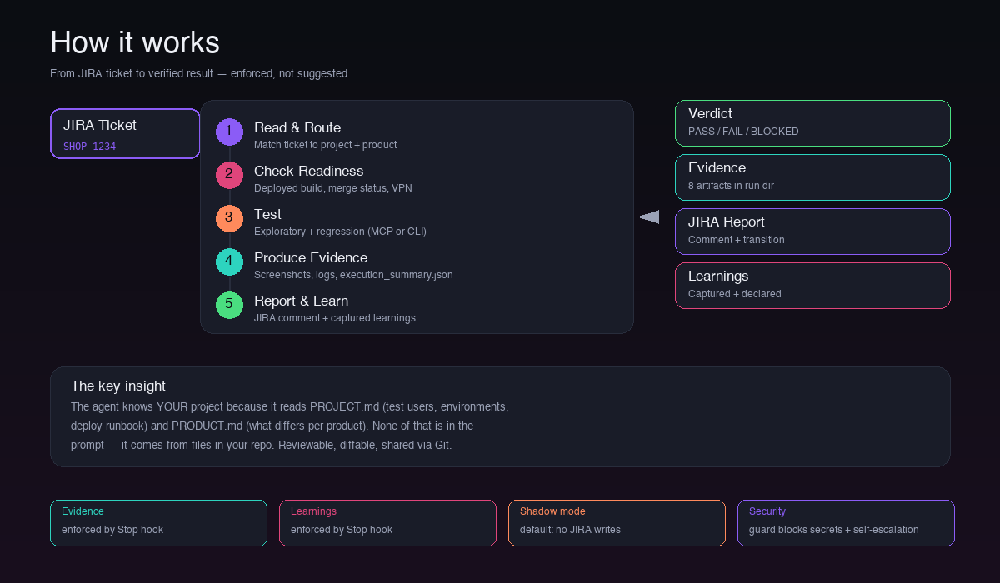

# QA Agent Blueprint

[](https://github.com/Sn4kyGit/qa-agent-blueprint/actions/workflows/ci.yml)
[](LICENSE)
[](https://github.com/Sn4kyGit/qa-agent-blueprint/releases)



**Turn Claude Code or opencode into a QA Manager that tests tickets autonomously.**

Hand it a JIRA ticket — it tests or re-tests the ticket, produces evidence, reports
back in your project's format, and remembers what it learned.

```
/test-ticket SHOP-1234
→ reads the ticket, routes to your project
→ tests it (exploratory + regression)
→ produces evidence (screenshots, logs, summary)
→ reports back to JIRA
→ captures learnings for next time
```

**⭐ Star this repo if you find it useful — it helps others discover it!**

> **⚠️ Alpha status.** This project is under active development. APIs, file
> formats, and behavior may change between releases. It is tested against
> fixtures and a fictional reference project — no real-world deployment has
> been validated yet. Use it, break it, and tell us what happens.

**Found a bug or have feedback?** Open a [GitHub issue](https://github.com/Sn4kyGit/qa-agent-blueprint/issues) —
we want to hear about problems, unexpected behavior, and what worked well.
Bugs, feature requests, and "here's what happened when I tried it" are all
welcome. For security vulnerabilities, see [SECURITY.md](SECURITY.md).

---

## Quick start

```bash
# 1. Install (Claude Code)
claude plugin marketplace add Sn4kyGit/qa-agent-blueprint
claude plugin install --scope project qa-agent-blueprint@qa-agent-blueprint-marketplace

# 2. Restart Claude Code, then onboard your project
/onboard-project

# 3. Test a ticket
/test-ticket SHOP-1234
```

That's it. The agent knows your project because it reads the files in your repo.

---

## What makes it different

| | Ordinary AI testing | QA Agent Blueprint |
|---|---|---|
| **Project knowledge** | Generic, forgets between sessions | Reads `PROJECT.md` + `PRODUCT.md` — test users, environments, deploy runbook, gotchas |
| **Evidence** | "Looks good!" | Mandatory `execution_summary.json` + screenshots — a Stop hook *enforces* it |
| **Learning** | Starts fresh every session | Every run declares what it learned — the hook checks the declaration |
| **Token cost** | Burns context re-reading files | 7k always-loaded budget, on-demand skills, Fast Path for simple tickets |
| **Security** | Trusts the agent | Guard blocks secrets, destructive commands, self-escalation — audited |

**Five things that make it different** (read more below):

1. **It knows your projects** — test users as vault references, environments, deploy
   runbook, report format. Multi-product? Each product file states only what differs.
2. **Evidence is mandatory and enforced** — no verdict without artifacts. A Stop hook
   blocks the session end otherwise.
3. **Learning is enforced too** — every run declares what it learned. "Explain once,
   never again."
4. **Token-efficient by design** — slim router, on-demand skills, Fast Path for simple
   tickets, browser transcripts stay in subagents.
5. **Security-audited** — guard blocks secret reads, shadow mode, destructive commands,
   self-escalation. 47+ fixtures prove it.

---

## How it works

You type a ticket. The agent does the rest.



```
/test-ticket SHOP-1234

  → reads the ticket           (JIRA)
  → routes to project & product (SHOP → STOREFRONT)
  → checks readiness            (deployed build, merge status)
  → tests it                    (exploratory + regression)
  → produces evidence           (screenshots, logs, summary)
  → reports back                (JIRA comment, attachments, transition)
  → captures learnings          (enforced, not suggested)
```

The agent knows *your* project because it reads `PROJECT.md` (test users,
environments, deploy runbook) and `PRODUCT.md` (what differs per product).
None of that is in the prompt — it comes from files in your repo.

**33 skills · 9 subagents · 4 hooks · 2 MCP servers** — all in plain Markdown,
reviewable and diffable through Git.

> 📖 **[Detailed overview](https://sn4kygit.github.io/qa-agent-blueprint/overview.html)** —
> the whole architecture on one page.

---

## Who's at the wheel — three execution modes

One line in the project file decides how a ticket is tested: live via browser (MCP)
or through a pre-written script (CLI) — or the tactical mix. Every JIRA report
carries the mode, so it is clear whether a result was observed or merely asserted.

| Mode | How it's tested | Cost | When |
|---|---|---|---|
| `mcp-only` | Model drives live, every step | High | New project, exploratory, visual, high risk |
| `hybrid` (default) | Probe → spec via CLI → red probe → short live check | Medium | The everyday case; pays off from the first retest |
| `cli-first` | The suite only; MCP only on unclear failures | Low | Maintained suite, regression, pipeline |

Four rules keep hybrid mode honest: no blindly written spec (recon first),
positive and specific assertions, the **red probe** (a spec that was never red
proves nothing) and the observation channel in every run. Escalation is automatic:
visual ticket, high risk, missing recon or unclear failure → always live.

---

## Knowledge architecture

```
projects/SHOP/
├── PROJECT.md          ← applies to ALL products, holds the routing registry
├── learnings.md
├── flow-map.md         ← curated by /retro-learn: flows, anchors, neighbors
├── templates/bug-report.md
└── products/           ← completely absent in single-product projects
    ├── STOREFRONT/     ← lists ONLY what differs (~60 lines)
    └── ADMIN/
```

**The trick**: wherever a rule says `PROJECT.md`, it means the *effective* project
file — the project file merged with the routed product file. No routed product
means nothing merged, behavior exactly as before.

**Routing ladder**: explicit → component → label → project-wide → secondary
signals → default → ask. A default resolves *silence*, never a *conflict*.

**What a product may override**: environments, test users, test assets, feature
matrix, gotchas → yes. Quality gates → stricter only. Deploy/MR permissions →
restricting only. JIRA transitions, report format, mandatory evidence → never.

---

## The learning loop

**Capture is enforced.** Every run declares what it learned — or why nothing
came up. A Stop hook blocks the session end if the declaration is missing.

**Grooming is visible.** Session start reports the number of ungroomed entries
so no backlog grows silently.

**Promotion is the goal.** Seen twice means: into a rule, a project or product
file — there it is loaded automatically and never explained again. Flow knowledge
moves into the **flow map** (`flow-map.md`): `/retest-bug` aims its regression
sweeps at the neighboring flows curated there, instead of guessing.

---

## Install

### Claude Code (plugin — recommended)

```bash
claude plugin marketplace add Sn4kyGit/qa-agent-blueprint
claude plugin install --scope project qa-agent-blueprint@qa-agent-blueprint-marketplace
```

Restart Claude Code and accept the trust dialog. That's it.

**Or use the installer wizard** (guided, one question at a time):

```bash
git clone https://github.com/Sn4kyGit/qa-agent-blueprint.git ~/qa-blueprint
~/qa-blueprint/install.sh --target <your-project>
```

### opencode (any model: Kimi, GLM, GPT, …)

```bash
git clone https://github.com/Sn4kyGit/qa-agent-blueprint.git ~/qa-blueprint
~/qa-blueprint/install.sh --mode opencode --target <your-project> --yes
```

Model-agnostic — use whatever model you have via `/models`. The blueprint pins none.

### Both harnesses (shared QA home)

```bash
~/qa-blueprint/install.sh --mode shared --target <your-project>
```

Alternating Claude Code and opencode in one QA home, no re-onboarding.

### Prerequisites

- Node.js ≥ 18 (`brew install node`)
- Claude Code (`npm install -g @anthropic-ai/claude-code`) or opencode (`npm install -g opencode-ai`)
- GitHub auth (`gh auth login`) — needed while the repo is private

<details>
<summary><b>Manual install</b> (no wizard)</summary>

1. Add the marketplace: `claude plugin marketplace add Sn4kyGit/qa-agent-blueprint`
2. Install the plugin: `claude plugin install --scope project qa-agent-blueprint@qa-agent-blueprint-marketplace`
3. Restart and accept the trust dialog.

The plugin registers hooks, skills, agents, and MCP servers automatically.

</details>

---

## After the install

1. **Onboard your project**: `/onboard-project` — fills `PROJECT.md` from the template
   (test users, environments, deploy runbook, report format)
2. **Add products** (optional): `/onboard-product` — for JIRA projects covering
   several products with different test methods
3. **First test**: `/test-ticket SHOP-1234`
4. **Shadow mode is ON by default** — the agent composes reports but posts nothing
   until you write `Shadow mode: off` in the project file

### Updating

```bash
claude plugin marketplace update qa-agent-blueprint-marketplace
claude plugin update --scope project qa-agent-blueprint
```

---

## What's in the box

| Component | Count | What it does |
|---|---|---|
| **Skills** | 33 | Test workflows, bug reports, analysis, reporting, learning |
| **Subagents** | 9 | qa-manager, test-executor, test-automator, failure-analyst, bug-reporter (+ cheap/deep lanes) |
| **Hooks** | 4 | SessionStart (bootstrap), PreToolUse (guard), Stop (evidence gate), PostToolUse (audit) |
| **MCP servers** | 2 | playwright (browser), atlassian (JIRA) |
| **Always-loaded rules** | 5 | evidence-policy, product-layer, qa-principles, security, token-discipline |
| **On-demand docs** | 12 | Detailed rules, read when the topic comes up |
| **Tests** | 17 suites + 152 bun | Fixture battery, manifest conventions, eval cases (46) |

### Skills you'll use most

| Command | What it does |
|---|---|
| `/test-ticket KEY-123` | Full workflow: read → route → test → evidence → report |
| `/retest-bug KEY-123` | Focused re-test + regression sweep |
| `/qa-report` | Aggregate evidence into metrics |
| `/perf-analysis` | Duration, token usage, bottlenecks |
| `/retro-learn` | Capture, groom, promote learnings |
| `/onboard-project` | Teach the agent a new project |

<details>
<summary><b>All 33 skills</b></summary>

**Core workflow**: test-ticket, retest-bug, exploratory-testing, test-automation, recon, failure-analysis, bug-report, report-to-jira, deploy-to-stage, onboard-project, onboard-product, re-board, scaffold-suite, qa-report, retro-learn, whats-new, skill-review, perf-analysis, demo, qa-help, agentswitch, model-setup

**Vendored** (MIT, from [petrkindlmann/qa-skills](https://github.com/petrkindlmann/qa-skills)): api-testing, accessibility-testing, security-testing, visual-testing, risk-based-testing, bug-reproduction, test-reliability, qa-metrics, test-case-management, release-readiness

**Framework**: webdriverio-testing (loaded automatically when the project uses WDIO)

</details>

---

## What is enforced, not just written down

| Rule | How it's enforced |
|---|---|
| No verdict without evidence | Stop hook blocks session end |
| Every run declares learnings | Stop hook checks the declaration |
| Secrets never enter context | PreToolUse guard blocks reads |
| Shadow mode (no JIRA writes) | Guard blocks writes by default |
| No destructive commands | Guard blocks rm -rf, force push |
| No guard self-escalation | Agent can't edit guard/rules/skills |

---

## Security & privacy

- **No telemetry** — nothing leaves your machine
- **No license checks** — Apache 2.0, free forever
- **Secrets are references** — vault paths or env keys, never values
- **Stage-only** — never production
- **Guard is defense-in-depth** — regex-based, audited, 47+ fixtures prove it blocks

---

## What does it cost to run?

- **Always-loaded context**: ~7k tokens (budget: 8.4k, measured)
- **Skill bodies**: loaded on demand, ~2-7k tokens per skill
- **Browser transcripts**: stay inside subagents (never in your context)
- **Fast Path**: simple tickets skip the manager → fewer tokens

The blueprint is token-efficient by design. A typical test run costs 50-150k
input tokens (mostly browser interaction) and 5-15k output tokens.

---

## Deliberate non-goals

- No memory server — knowledge lives in plain Markdown, shared via Git
- No pipeline editing — the blueprint runs in your pipeline, not the other way around
- No merges, approvals, or rollbacks — it comments, humans decide
- No autonomous write-back to test management — payloads for human review only

<details>
<summary><b>Not built yet, and honest about it</b></summary>

- Web only (Chromium) as default — mobile/cross-browser via WDIO+Appium is reference-only
- One ticket at a time — epics and releases have no rollup
- No test-data lifecycle or stage leases — parallel testing on shared stages will confuse itself
- No project has been onboarded for real yet — everything is verified against fixtures
  and a fictional reference project. The first pilot is the actual test.

</details>

---

## Bringing it into an existing repo

```bash
# Plugin mode (recommended — nothing copied into your repo)
claude plugin marketplace add Sn4kyGit/qa-agent-blueprint
claude plugin install --scope project qa-agent-blueprint@qa-agent-blueprint-marketplace

# Or integrate mode (copies files into your repo, reviewable by your team)
git clone https://github.com/Sn4kyGit/qa-agent-blueprint.git ~/qa-blueprint
~/qa-blueprint/install.sh --mode integrate --target <your-project>
```

| | Plugin (A) | Integrate (B) |
|---|---|---|
| **Lands in your repo** | Nothing (plugin cache) | Rules, skills, agents, hooks |
| **Logic lives in** | Plugin cache, updated via `/plugin` | Your repo, in your commits |
| **Commands** | `/qa-agent-blueprint:test-ticket` | `/test-ticket` |
| **Best when** | Zero footprint across many repos | Reviewable and editable by your team |

---

## Test user passwords: Keychain setup (macOS)

```bash
security add-generic-password -s SHOP_QA_STANDARD_PASSWORD -a qa -w
```

Keys are declared in `PROJECT.md` → "Test users". Values live in the macOS
keychain or `.env.playwright-secrets` (gitignored). The agent sees key names,
never values.

---

## Documentation

| Document | Contents |
|---|---|
| [Detailed overview](https://sn4kygit.github.io/qa-agent-blueprint/overview.html) | Architecture on one page |
| [docs/quickstart-plugin.md](docs/quickstart-plugin.md) | Plugin install walkthrough |
| [docs/quickstart-opencode.md](docs/quickstart-opencode.md) | opencode install walkthrough |
| [docs/architecture.md](docs/architecture.md) | Five layers, token budgets |
| [docs/pilot-briefing.md](docs/pilot-briefing.md) | Read before the first real onboarding |
| [docs/rules/](docs/rules/) | Detailed rules, read on demand |
| [evals/COVERAGE.md](evals/COVERAGE.md) | Norm → test matrix (46 cases) |

---

## Contributing & feedback

The best way to help right now is to **use it and tell us what happens**.

- **Found a bug?** [Open an issue](https://github.com/Sn4kyGit/qa-agent-blueprint/issues) —
  steps to reproduce + what you expected vs. what happened
- **Something felt off?** Same — unexpected behavior is just as valuable as hard bugs
- **It worked well?** We'd love to hear that too (and a ⭐ helps others find it)
- **Want to contribute code?** See [CONTRIBUTING.md](CONTRIBUTING.md) — fork, test, PR

**Key rules for PRs**: no project data in commits, no secrets, no dependency additions (stdlib only).

---

## Contributors

| | |
|---|---|
| **[Sn4kyGit](https://github.com/Sn4kyGit)** | Architecture, development, security audit, testing |
| **[Anna Mazurek](https://github.com/annamazurek-qa)** | Requirements, conception, feedback, testing |

---

## License

[Apache 2.0](LICENSE). Methodology draws on Google testing standards, OWASP Top 10,
and blameless SRE retrospective practice.
